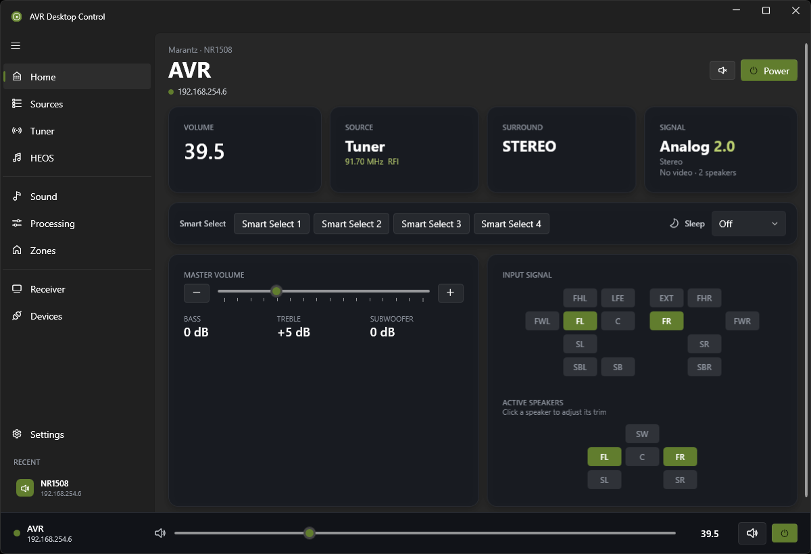
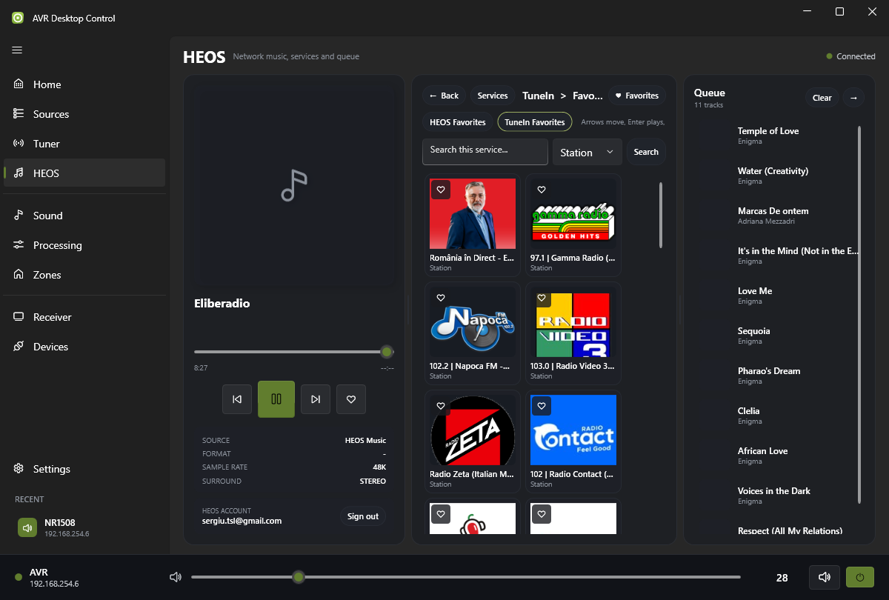

# DENON Desktop Control

<p align="center">
  
</p>

**Full remote control for Denon and Marantz receivers on Windows.**  
Modern Fluent/Mica interface, HEOS integration with Tidal and TuneIn browsing, AM/FM radio tuner with saved stations, floating system-tray widget, automatic network discovery, real-time monitoring, UPnP seek and complete control of volume, sources, channels, zones and sound profiles.

[](https://github.com/sreddev/denon-desktop-control_tuner/releases)
[](LICENSE)

---

## Features

### 📻 AM / FM Radio (Tuner)

- 📡 **Now tuned** — Large frequency readout, band (FM / AM), AUTO / MANUAL mode and the RDS station name on models that report it
- ⌨️ **Manual tuning** — Type a frequency and press Enter: `95.5` (or `95,5`) tunes FM in MHz, `1010` tunes AM in kHz; the band is detected automatically
- ⏩ **Seek and step** — Seek to the next receivable station, or step one frequency at a time using the receiver's regional step size
- 💾 **Saved stations** — Add, edit and delete stations; click one to listen; previous / next buttons cycle through the list
- 🔢 **Numbered list** — Each station shows its position (01, 02, 03…); the station currently tuned is highlighted
- 📥 **Import receiver presets** — The presets stored in the receiver (names + frequencies) are imported automatically the first time, and can be re-imported at any time with the download button; the receiver itself is never modified
- 🔀 **Automatic input switch** — Tuning switches the main zone to the **TUNER** input when another source is selected

### HEOS — Network music

- 🎵 **Service browsing** — TuneIn (local radio), Tidal, Local Music, Playlists, Favorites
- 🔍 **Search** — By Artist, Album, Track and Playlist within each service
- ▶️ **Direct playback** — Click a result to play it instantly
- 📋 **Play queue** — Cover art, click to jump, clear button
- ⏩ **Working seek** — Drag the time bar to skip forward or back (via [UPnP AVTransport](https://en.wikipedia.org/wiki/Universal_Plug_and_Play))
- 🎨 **Blurred background** — The current album cover as a Spotify-style blurred backdrop
- 👤 **HEOS sign-in** — Sign in to enable Tidal, TuneIn, Deezer and favorites
- 🖼️ **Square tiles** — Services shown with large logos and intuitive navigation

### Receiver control

- 🔍 **Auto-discovery** — Finds your AVR via [SSDP/UPnP](https://en.wikipedia.org/wiki/Simple_Service_Discovery_Protocol) + subnet scan
- 🎚️ **Master volume** — Debounced slider, +/- buttons, configurable unit (absolute, dB, %)
- 🔊 **Per-channel level** — Individual trim for FL, FR, C, SL, SR, SW (±12 dB)
- 💾 **Sound profiles** — Save and recall speaker balances with one click (Normalize, Save, Load)
- 📡 **Channel matrix** — Real-time view of the input signal and active speakers
- 🎛️ **Sources** — Quick switching using the receiver's own input names (SHIELD, ROG GAME, nintendo...)
- 🎭 **Surround modes** — Stereo, Direct, Pure Direct, Multi Ch, Neural:X, Dolby and more
- 🎵 **Tone** — Bass, Treble and Subwoofer with fine control
- 🏠 **Zones** — Independent control of Main and Zone 2 (Zone 2 never turns on by itself)

### Interface

- 📌 **Floating widget** — Single-click the tray icon for a mini control, double-click for the full window
- 🌐 **Bilingual** — Spanish / English, chosen automatically from your Windows language
- 🔄 **Automatic updates** — Checks for new versions at startup from [haussmed.cl](https://haussmed.cl/denon/)
- ⚡ **Smart reconnection** — HTTP fallback while the AVR is in standby
- 🔇 **Mute indicator** — Red icon and text while the receiver is muted
- 🖥️ **Dark mode** — High-contrast Fluent/Mica interface

---

## Compatibility

| | |
|---|---|
| **Receivers** | Any Denon or Marantz with a network port (AVR-X, AVR-S, Cinema, NR, SR series) |
| **Protocols** | Telnet (23) · HTTP goform (8080/80) · [HEOS CLI](https://assets.denon.com/documentmaster/uk/heos_cli_protocolspecification.pdf) (1255) · [UPnP AVTransport](https://en.wikipedia.org/wiki/Universal_Plug_and_Play) (60006) |
| **Windows** | 10 / 11 (x64) |
| **Tested with** | Denon AVR-S970H · Marantz NR1508 |

---

## Installation

### Direct download

1. Go to [**Releases**](https://github.com/sreddev/denon-desktop-control_tuner/releases)
2. Download `DenonDesktopControl-1.6.0.zip` (portable)
3. Unzip and run `DenonDesktopControl.exe` — no .NET installation needed (self-contained)

### Build from source

```bash
git clone https://github.com/sreddev/denon-desktop-control_tuner.git
cd denon-desktop-control_tuner/src/DenonRemote
dotnet run
```

Requires the [.NET 8 SDK](https://dotnet.microsoft.com/download/dotnet/8.0). You can also open `DenonDesktopControl.sln` in Visual Studio.

---

## Usage

1. On launch, the app tries to connect to the last known receiver
2. The first time, go to **Devices** and press **Rescan**, or add the IP manually
3. **Click** the tray icon = quick widget
4. **Double-click** = full window
5. In **HEOS**: pick a service, browse or search, click to play
6. In **Radio**: click a saved station to listen, type a frequency to tune manually, or use seek / step; manage stations with the editor below the list

---

## Tech stack

| Component | Technology |
|---|---|
| Framework | [.NET 8](https://dotnet.microsoft.com/) + WPF |
| UI | [WPF-UI](https://github.com/lepoco/wpfui) 3.0.5 (Fluent/Mica) |
| MVVM | [CommunityToolkit.Mvvm](https://github.com/CommunityToolkit/dotnet) 8.4 |
| Tray | [H.NotifyIcon](https://github.com/HavenDV/H.NotifyIcon) |
| AVR control | Raw telnet socket (real-time push events) |
| AVR fallback | HTTP goform API (power on from standby) |
| HEOS | Denon proprietary TCP CLI protocol |
| Seek | UPnP SOAP (AVTransport:1) |
| Installer | [Inno Setup](https://jrsoftware.org/isinfo.php) |

---

## Technical notes

- **Seek**: the HEOS CLI doesn't support seek (`Command not recognized`). The official app uses UPnP AVTransport SOAP on port 60006, which is what this app implements.
- **Tidal "My Music"**: personal folders return the root in a loop through the CLI (an S-series firmware bug). Searching by playlist name works as an alternative.
- **Blurred background**: WPF has no CSS-style `backdrop-filter`, so a `BlurEffect` is applied to an `ImageBrush` on a `Rectangle`, with semi-transparent cards on top.
- **Zone 2**: `PWON` powers on every zone, so the app uses `ZMON` + `Z2OFF` to power on Main only.
- **Tuner**: frequencies are sent with `TFAN` as six digits (value × 100: `TFAN009550` = 95.50 MHz, `TFAN101000` = 1010 kHz). Tuner commands are ignored unless the input is TUNER, so the app switches input first. Stepping needs MANUAL mode, which on Denon/Marantz also forces FM to mono, so AUTO is restored after each step. Receiver presets are read with `OPTPN ?`; the protocol has no command to rename or erase a preset, which is why saved stations are kept in the app (`%LocalAppData%\DenonRemote\settings.json`).

---

## Screenshots

<p align="center">
  
  
</p>

---

## Contributing

See [CONTRIBUTING.md](CONTRIBUTING.md) for development instructions and the project structure.

---

## Credits

Originally created by **Felipe** · Buin, Santiago de Chile — [felipedream/denon-desktop-control](https://github.com/felipedream/denon-desktop-control)

| | |
|---|---|
| Telegram | [@felipedream](https://t.me/felipedream) |
| Email | felipedream@gmail.com |
| Donate | [](https://www.paypal.com/donate/?business=felipedream@gmail.com&currency_code=USD) |

---

## License

[MIT](LICENSE) — Use it, modify it, distribute it freely.
