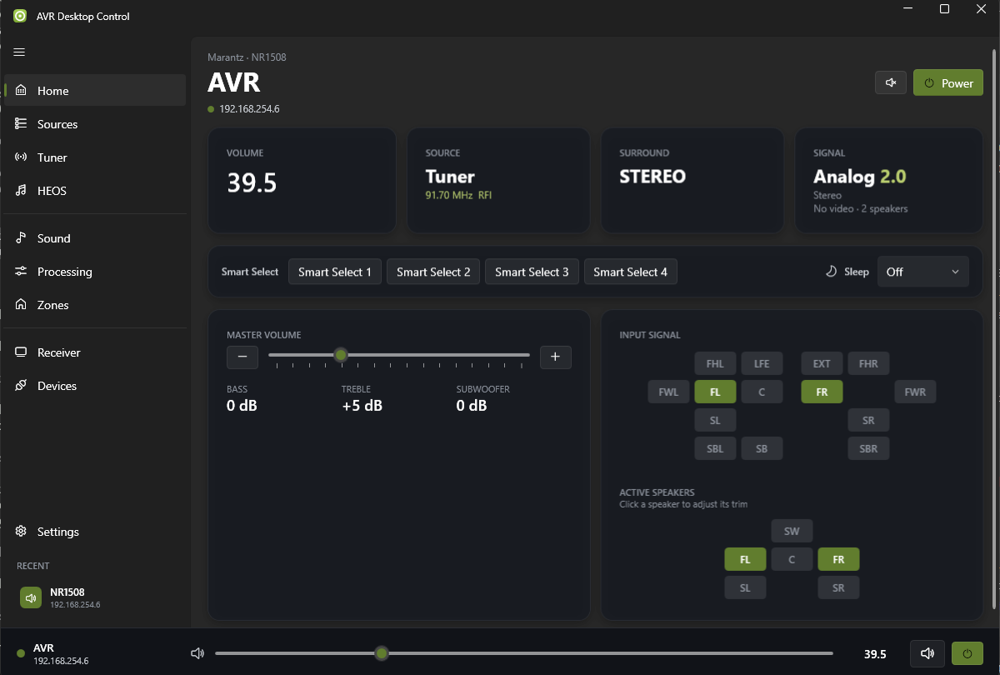
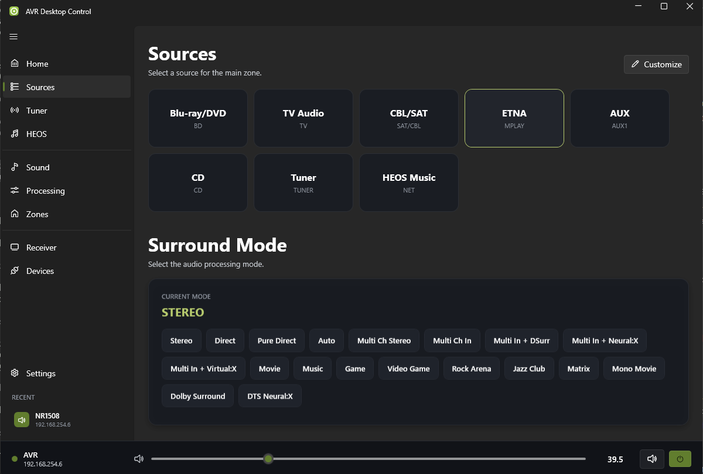
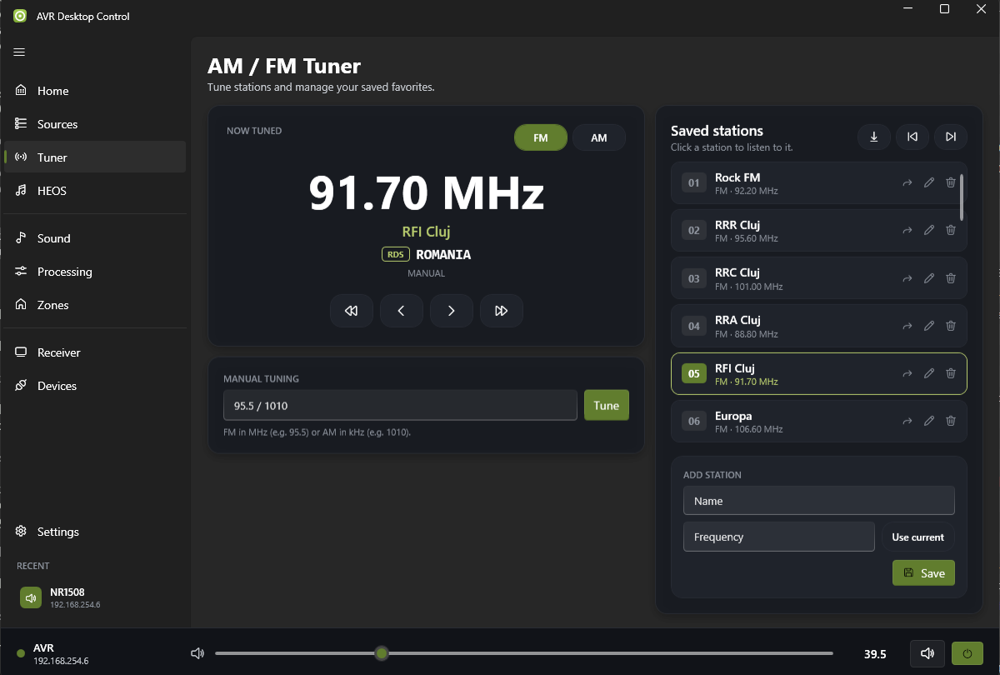
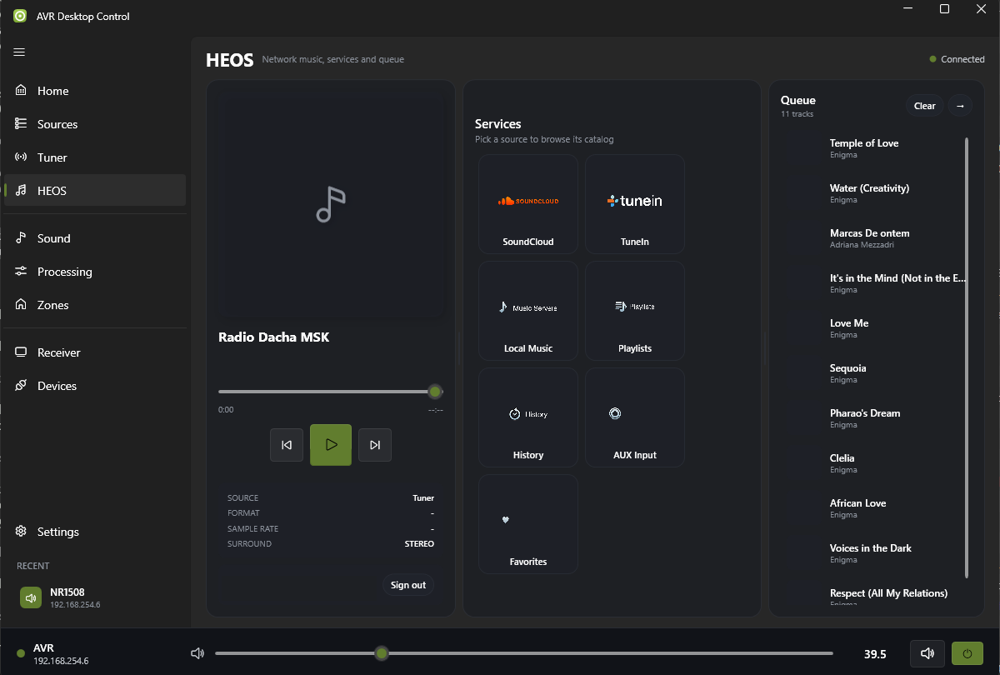
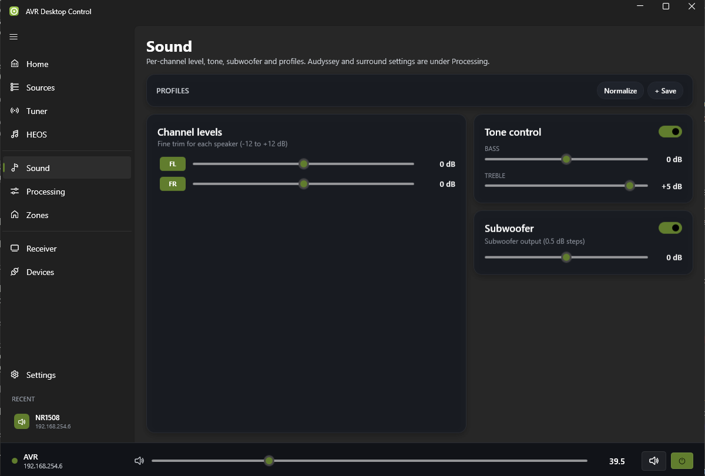
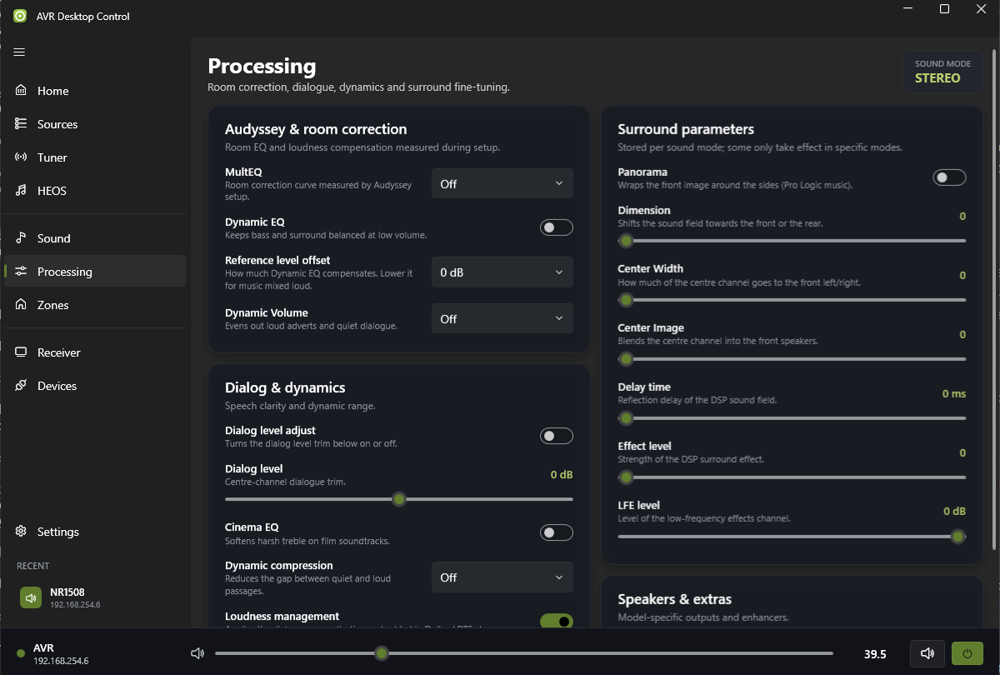
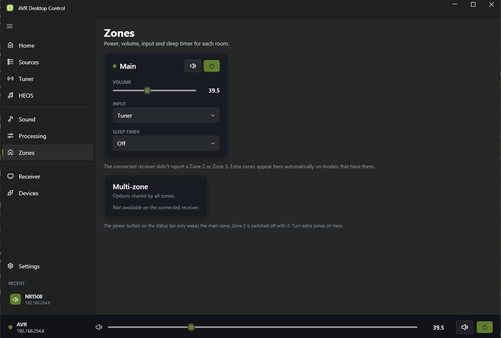
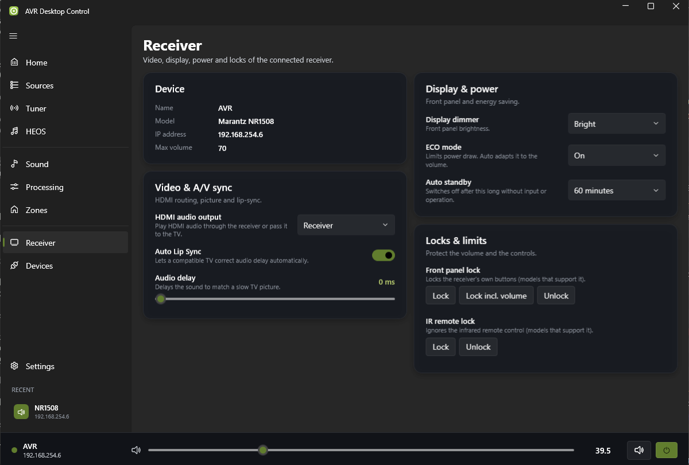
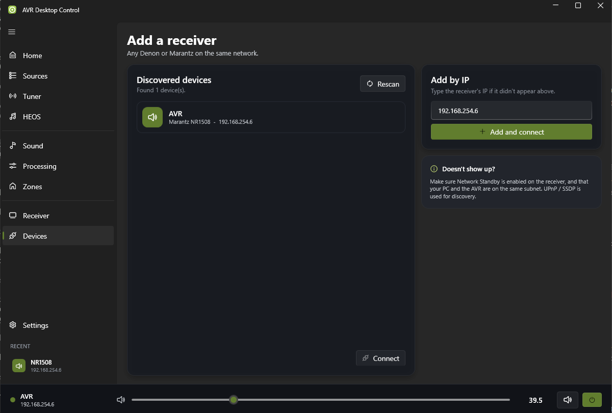
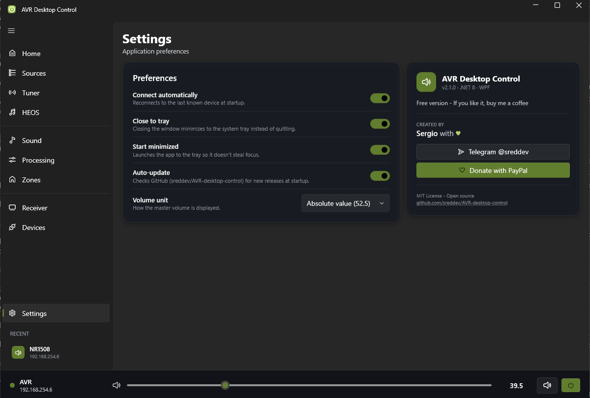

# AVR Desktop Control — User Guide

This guide covers every page of the app. For download and installation, see the [README](../README.md#download-and-install).

## Contents

1. [Before you start](#1-before-you-start)
2. [The window at a glance](#2-the-window-at-a-glance)
3. [Home](#3-home)
4. [Sources](#4-sources)
5. [Tuner](#5-tuner)
6. [HEOS](#6-heos)
7. [Sound](#7-sound)
8. [Processing](#8-processing)
9. [Zones](#9-zones)
10. [Receiver](#10-receiver)
11. [Devices](#11-devices)
12. [Settings](#12-settings)
13. [Tray icon, widget and menu](#13-tray-icon-widget-and-menu)
14. [Troubleshooting](#14-troubleshooting)
15. [FAQ](#15-faq)

---

## 1. Before you start

- **Same network**: the PC and the receiver must be on the same local network (same subnet).
- **Network Standby**: in the receiver's setup menu, turn on *Network → Network Control* (called *Network Standby* on some models). Without it, the receiver can't be reached or switched on while in standby.
- **Only one remote over telnet**: Denon and Marantz receivers accept a single telnet connection. If another app holds it (Home Assistant, another remote app), this app falls back to HTTP and some live updates will be missing.

> **Your model decides what you see.** The app asks the receiver about each setting and shows only the ones it answers. If a control from this guide is missing, your receiver doesn't have that feature, or doesn't offer it over the network.

---

## 2. The window at a glance

- **Sidebar**, in three groups:
  - **Listening**: Home, Sources, Tuner, HEOS
  - **Audio**: Sound, Processing, Zones
  - **System**: Receiver, Devices
  - **Settings** sits at the bottom, with your **recent receivers** under it. Click one to connect.
- **Status bar** at the bottom, on every page:
  - connection dot, receiver name and IP
  - master volume slider and value, with a "MUTE" label in the accent colour while muted
  - **Mute** and **Power** buttons. Power switches only the **main zone**; Zone 2 never wakes up with it.
- The ☰ button collapses the sidebar to icons.

---

## 3. Home

| Area | What it does |
|---|---|
| **Header** | Brand, model, name and IP of the connected receiver; Mute and Power |
| **Volume** | Current master volume, in the unit chosen in Settings |
| **Source** | Current input. **Click** to pick another one. On the tuner it also shows the frequency and the live RDS name |
| **Surround** | Current sound mode. **Click** to choose another |
| **Signal** | Signal type (Analog, PCM…), channel layout (2.0, 5.1, 7.1.4…), sample rate, decoder, video in → out and active speaker count. **Click** to refresh |
| **Quick / Smart Select** | The receiver's memory slots, with the names stored in the receiver. **Click** a slot to recall its input, volume and sound settings. **Right-click → Store** saves the current settings into it. The active slot is highlighted |
| **Sleep** | Turns the main zone off after 10–120 minutes. While a timer runs, some models report the minutes left |
| **Master volume** | Slider and −/+ buttons, plus the current bass, treble and subwoofer levels |
| **Input signal** | Which channels the source carries (green = present in the signal) |
| **Active speakers** | Which speakers are playing. **Click** a green speaker to open a trim slider for it (±12 dB, 0.5 dB steps) |

---

## 4. Sources

- **Input tiles**: click to switch the main zone's input. Tiles show the receiver's own input names, with the internal code underneath.
- **Customize**: rename an input or hide it everywhere in the app (Home, Zones, Sources). Leave a name empty to go back to the receiver's name. These names are stored in the app only and never change the receiver.
- **Surround Mode**: the current mode, plus a button for each common mode. Modes your receiver doesn't support for the current signal are ignored by it.

---

## 5. Tuner

**Now tuned**
- **Frequency** in large type, with **FM / AM** band buttons.
- **Your saved name** for the station (green), when the frequency is in your list.
- **RDS name**: the station name the broadcaster sends over RDS, live, next to an *RDS* badge. Many stations rotate several texts in it (name, slogan, website), and the line follows them. AM and stations without RDS show nothing.
- **AUTO / MANUAL**: AUTO seeks and receives in stereo. MANUAL steps one frequency at a time; on Denon/Marantz it also forces FM to mono. The app switches back to AUTO after each step.
- **⏪ ⏩** seek to the previous / next receivable station; **‹ ›** step one frequency down / up.

**Manual tuning**: type `95.5` (or `95,5`) for FM in MHz, or `1010` for AM in kHz, then press **Enter** or **Tune**. The band is detected from the number.

**Saved stations**
- Click a station to tune to it; the playing station is highlighted.
- **⬇ Import** copies the receiver's own presets (names and frequencies) into the list, skipping ones you already have. This happens automatically the first time.
- **⏮ ⏭** cycle through the list, wrapping around at the ends.
- Per station:
  - **↪ Skip**: dims the station and leaves it out of previous / next. Click again to include it
  - **✎ Edit** and **🗑 Delete**
- **Add station**: type a name and frequency, or press **Use current** to fill in what's playing (including the RDS name).

Any tuning action switches the main input to **TUNER** first, if needed.

---

## 6. HEOS

- **Now playing**: cover art (also used as a blurred page background), title, artist, a seek bar you can drag, and previous / play-pause / next.
- **Services**: TuneIn, Tidal, SoundCloud, local music servers, playlists, history, favorites, AUX. Click a tile to browse; use the search box where a service supports it (artist, album, track, playlist).
- **Queue**: click a track to jump to it; **Clear** empties the queue.
- **HEOS account**: sign in to use streaming services and favorites. The app sends your credentials only to the receiver.

---

## 7. Sound

- **Profiles**: save the current channel trims, bass, treble, subwoofer and tone setting as a named profile.
  - **Click** a profile chip to load it
  - **Double-click** it to rename
  - **✕** deletes it
  - **Normalize** sets every trim back to 0 dB
- **Channel levels**: a ±12 dB trim slider for each speaker the receiver reports as connected. A green label means that speaker is playing in the current mode.
- **Tone control**: switch it on to use **Bass** and **Treble** (±6 dB).
- **Subwoofer**: level ±12 dB in 0.5 dB steps, plus an on/off switch for the subwoofer output on models that support it.

Audyssey, dialogue and surround settings are on the **Processing** page.

---

## 8. Processing

The current sound mode is shown at the top right, because several of these values are stored **per sound mode**. The app re-reads them each time the mode changes.

| Card | Settings |
|---|---|
| **Audyssey & room correction** | MultEQ curve (Reference, L/R Bypass, Flat, Manual, Off), Dynamic EQ, Reference Level Offset (0 / 5 / 10 / 15 dB), Dynamic Volume (Heavy / Medium / Light / Off), LFC and its containment amount, Dirac Live filter slot |
| **Dialog & dynamics** | Dialog Enhancer, Dialog Level adjust and trim, Cinema EQ, Dynamic Compression, Loudness Management |
| **Surround parameters** | Center Spread, Panorama, Dimension, Center Width, Center Image, Delay Time, Effect Level, Room Size, LFE level, Neural:X. Most only affect specific modes (Pro Logic, Neural:X, DSP modes) |
| **Speakers & extras** | Front Speaker A / B / A+B, Graphic EQ, Compressed Audio Restorer, Bluetooth transmitter and its output mode |

A card that says *"Not available on the connected receiver"* means your model reported none of its settings.

---

## 9. Zones

- Each zone the receiver has gets a card (**Main**, **Zone 2**, **Zone 3**), with:
  - **Power** and **Mute**
  - a **volume** slider
  - an **input** picker, which uses your hidden / renamed inputs
  - a **sleep timer**, when the zone supports one
- **All Zone Stereo** plays the main zone's audio in every zone, on models that support it.
- Zone 2 only turns on from this page, and turns off whenever the main zone is switched off with the Power button.

---

## 10. Receiver

| Card | Contents |
|---|---|
| **Device** | Name, brand and model, IP address, maximum volume |
| **Video & A/V sync** | HDMI audio output (receiver or TV), HDMI monitor output, output resolution, video mode, picture mode, aspect ratio, **Auto Lip Sync**, **Audio delay** (0–500 ms) |
| **Display & power** | Front panel **dimmer**, **ECO mode**, **auto standby** |
| **Locks & limits** | **Volume limit**, **front panel lock** (with or without volume) and **IR remote lock** |

> The lock buttons send their command without reading back the state, because receivers don't report it. If you lock the front panel, unlock it from here.

---

## 11. Devices

- **Discovered devices**: receivers found on the network. Select one and press **Connect**, or press **Rescan** to search again.
- **Add by IP**: type the receiver's address (shown in its *Network → Information* menu) and press **Add and connect**.
- Connected receivers are remembered under **Recent** in the sidebar, which keeps the last 5.

---

## 12. Settings

| Setting | Effect |
|---|---|
| **Connect automatically** | Reconnects to the last receiver at startup |
| **Close to tray** | The window's ✕ hides the app to the tray instead of quitting. Quit from the tray menu |
| **Start minimized** | Starts in the tray without opening the window |
| **Auto-update** | Checks GitHub at startup. When a newer version exists, a banner offers the download |
| **Volume unit** | Absolute (52.5, like the front panel), decibels (−27.5 dB) or percent of the maximum |

The **About** card shows the version, links to Telegram and the GitHub repository, and a PayPal button if you'd like to support the project.

---

## 13. Tray icon, widget and menu

- **Single-click** the tray icon to open the **mini remote** above the taskbar:
  - receiver name and source, Mute and Power
  - volume slider
  - sound mode and format
  - quick input buttons (CD, TV, Game, Bluetooth, HEOS)
  - Quick / Smart Select slots
  - sleep timer
  - a link to the full window

  It hides when you click elsewhere.
- **Double-click** the tray icon to open the full window.
- **Right-click** the tray icon for the menu: Show window, Power, Mute, Volume + / −, Quick / Smart Select slots, Quit.

---

## 14. Troubleshooting

| Problem | What to try |
|---|---|
| **The receiver isn't found** | Turn on *Network Control / Network Standby* on the receiver. Check that the PC and receiver are on the same subnet (not a guest Wi-Fi). Add it by IP in **Devices**. Allow the app through the Windows firewall if asked |
| **Connects, but values don't update** | Another app is probably holding the receiver's single telnet connection. Close it, then reconnect from the sidebar |
| **A feature from this guide is missing** | Your model doesn't report it, so it stays hidden. Some settings also only appear once the receiver is on |
| **Power on doesn't work from standby** | Network Control must be on, or the receiver ignores the network while asleep |
| **No RDS name** | The station doesn't broadcast RDS, reception is weak, or you're on AM |
| **Quick / Smart Select bar is empty** | The model has no Quick Select over the network |
| **The app crashed** | A crash report is written to `%TEMP%\DenonRemote-crash.log`. Please attach it to a [GitHub issue](https://github.com/sreddev/AVR-desktop-control/issues) |

---

## 15. FAQ

**Does the app change anything on the receiver by itself?**
No. On connect it only reads values. Commands are sent only when you use a control.

**Where are my settings stored?**
In `%LocalAppData%\DenonRemote\settings.json`: saved stations, profiles, input names, recent receivers and preferences. Uninstalling the app leaves the file in place.

**Does the app send data anywhere?**
It talks only to the receiver on your local network. At startup, if Auto-update is on, it also asks GitHub for the latest release.

**Can I control two receivers?**
One at a time. Switch between them from **Recent** in the sidebar or from **Devices**.

**Are renamed inputs and saved stations written to the receiver?**
No. They are stored in the app, so the receiver and its own remote keep their original names and presets.
